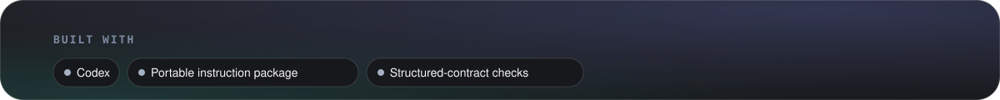

<a href="https://canessasyslabs.com/cetus/"><b>See it on canessasyslabs.com&nbsp;&nbsp;→</b></a>

Cetus brings scattered context into one coherent working model, then moves through a governed operating process: intake, context, requirements, strategy, planning, execution, validation and decision. Its discipline is simple: structure, validate, inspect, signal ready. Human acceptance and release approval stay separate decisions.

https://github.com/user-attachments/assets/fb0693c2-80a0-44ac-aae5-b968c0c01ab6

https://github.com/user-attachments/assets/41b89b55-bc6c-4d06-a85d-d0ac1f7ceec8

https://github.com/user-attachments/assets/fde1a2d3-d6f2-4449-b889-dd3e0ed5e10b

© Canessa System Labs. All rights reserved. This repository presents the work; it does not license it. No part of its text, images or design may be reused without written permission.

